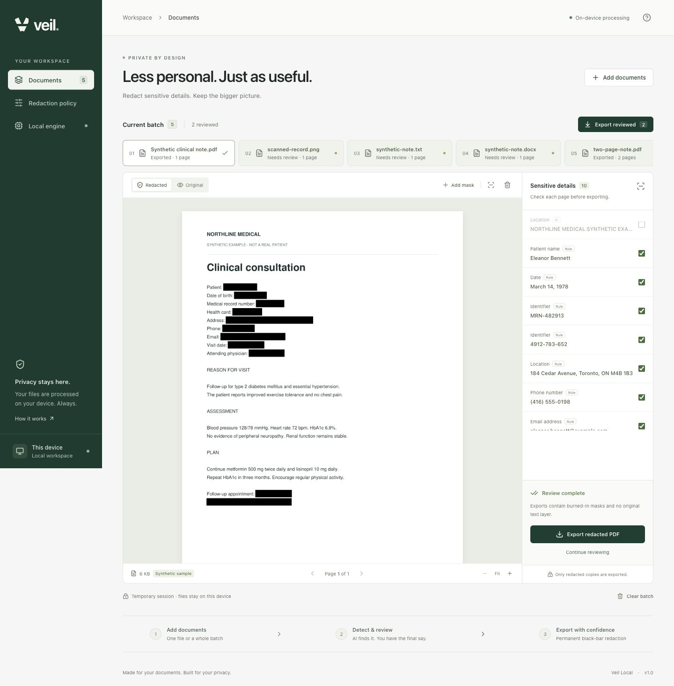

# Veil

Private medical-document redaction, on your Mac. Drop in a batch, detect identifying details with a local clinical model, review the pages, and export PDFs with permanent black bars.

**Your records never go to an AI service.** Internet is needed to install dependencies and download the model once. OCR, inference, previews, and exports run on the device afterward. No API key, account, or subscription.

## Quick start: clone and run on your Mac

Open **Terminal** and run:

```sh
git clone https://github.com/saikodakalla/veil.git
cd veil
bash start.sh
```

The launcher prepares an isolated Python 3.12 environment, installs the locked dependencies, and opens **http://127.0.0.1:8010** in your browser. The first launch can take a few minutes. Keep Terminal open while using the app.

1. In Veil, choose **Set up local engine** to download the clinical model once (approximately 440 MB). Wait for **Ready**.
2. Click **Try a sample**, or choose documents from the included [`sample-documents`](sample-documents) folder. Every included record is fictional.
3. Wait for local detection, compare **Original** and **Redacted**, and inspect every page. Toggle incorrect findings and use **Add mask** for anything missed.
4. Confirm **I've reviewed every page**, then choose **Export redacted PDF**. For a batch, review the documents and choose **Export reviewed** to download a ZIP.
5. Press **Control+C** in Terminal when finished. This stops the app and removes its temporary working copies. Your originals, browser downloads, and installed model remain.

### Requirements

- A Mac with macOS 12 or newer; 8 GB memory is recommended. Allow a few GB of free disk space for Python, dependencies, the model, and document processing.
- Internet for the first dependency/model installation. Once setup is complete, document processing works offline.
- **Git for the clone command above.** If macOS prompts you to install Apple Command Line Tools when you run Git, finish that installation and then rerun the commands. The ZIP option below avoids needing Git.
- The app installs its own Python runtime using [Astral uv](https://docs.astral.sh/uv/). You do not need to install Python, Node.js, npm, Homebrew, Ollama, or the full Xcode application yourself. The finished interface is included, and normal Mac OCR uses the installed Apple Vision bridge without compiling a helper.

**Mac compatibility:** Apple Silicon uses Metal/MPS when available, with CPU fallback. Intel Macs have a conditional CPU runtime. Apple Silicon was tested end to end; the older CPU runtime was tested separately, but Intel hardware itself was not available for local verification. Detection is English-only.

### Download without Git

1. [Download the source ZIP](https://github.com/saikodakalla/veil/archive/refs/heads/main.zip) and extract it.
2. Open the extracted folder and double-click **Start Veil.command**, or open Terminal in that folder and run `bash start.sh`.
3. Follow the model setup and document review steps above.

If Finder does not launch the command file, use the Terminal command. No build step is needed.

### Prepare for offline use

While you still have internet access, run this from the cloned folder:

```sh
bash start.sh --setup-only
```

Wait for the model installation to finish successfully. Later, launch normally with `bash start.sh`; neither inference nor OCR needs an internet connection.

### Troubleshooting

| What happens | What to do |
| --- | --- |
| The browser does not open | Keep Terminal open and visit [http://127.0.0.1:8010](http://127.0.0.1:8010/) yourself. Check Terminal for an error if the page is unavailable. |
| Port 8010 is already in use | Close the other Veil session, or run `VEIL_PORT=8011 bash start.sh` and use the URL printed in Terminal. |
| Finder reports a permission problem | Open Terminal in the project folder and run `bash start.sh`. |
| The model download fails | Check internet access and free disk space, then select **Retry model download** in Local engine, or run `bash start.sh --setup-only` again. Installation checks every file's checksum. |
| A document cannot be read | Use an unlocked PDF, a clear scan, UTF-8 text, or a text-only DOCX. Export Word documents with embedded images to PDF before importing. |
| You want to keep the browser closed at launch | Run `bash start.sh --no-browser`, then open the printed URL whenever ready. |
| You see no redactions or an unexpected result | Check the enabled policy, inspect the original and every output page, and add masks manually. Detection is not a guarantee that every identifier was found. |

### Update an existing clone

Stop Veil with **Control+C**, then run inside the repository:

```sh
git pull --ff-only
bash start.sh
```

Updated frontend files are already built. The launcher installs changed dependencies when the lockfile changes; model files stay cached locally.

## The workflow

- **Add documents:** select files, select a folder, or drag and drop. Up to 100 files per session, 50 MB per file, 200 MB per import request, and 300 pages per document. Documents are queued for local detection after import when the model is ready.
- **Set your policy:** names, clinicians, IDs, dates, ages, phone/fax numbers, email, locations/organizations, and URLs. Add session-only custom terms. Changes apply on the next scan. Use the scan-again button in a document toolbar to apply a new policy; it explicitly replaces that document's previous review and manual masks.
- **Review:** compare Original and Redacted, zoom into the page, toggle false positives, and use **Add mask** to cover anything missed. Page navigation and the findings list follow the current page. Confirm that you reviewed every page.
- **Export:** download a reviewed document or **Export reviewed** as a ZIP. Unreviewed or failed documents cannot be exported. Adding more documents does not reset an existing review.
- **Clear batch:** remove working copies from the temporary workspace. It does not remove your originals, downloaded exports, or model.

The built-in sample and every file in [`sample-documents`](sample-documents) are synthetic. The folder includes two TXT notes, two searchable PDFs, a scanned PNG, a scanned PDF, and an identifier checklist. Import the supported files, then compare the result against `expected-identifiers.json`. The checklist and README are reference files, not document inputs.

## Supported files

| Input | Handling | Output |
| --- | --- | --- |
| Searchable PDF | Text geometry; OCR also runs when images, forms, or visible annotations are present | Redacted PDF, same page layout |
| Scanned or mixed PDF | Local Apple Vision OCR on macOS | Redacted PDF, same page layout |
| PNG, JPG, TIFF (including multipage) | Local OCR | Redacted PDF |
| UTF-8 TXT | Reflow into reviewable pages | Redacted PDF |
| Text-only DOCX | Reflow text, tables, headers, footers, notes, and comments | Redacted PDF |

Word files containing embedded images, drawings, charts, or objects are rejected with instructions to export them as PDF first. Word formatting is not preserved. Encrypted PDFs must be unlocked before import. Missing/failed OCR and failed model inference block successful analysis; the app never quietly falls back to a rules-only detector.

## Model choice

Veil uses [StanfordAIMI/stanford-deidentifier-v2](https://huggingface.co/StanfordAIMI/stanford-deidentifier-v2), a compact BERT clinical de-identification model with an MIT license. The [authors' evaluation](https://arxiv.org/abs/2511.04079) concerns clinical/radiology text, which makes it a better fit for this application's initial scope than the general support-chat/log use described by the [Distil PII model card](https://huggingface.co/distil-labs/Distil-PII-Llama-3.2-1B-Instruct). This is a suitability decision, not a claim of best accuracy on every kind of medical record.

The model locates spans instead of rewriting clinical prose. Rules add coverage for medical IDs, Canadian health-card patterns, contact fields, dates, and addresses. Overlapping token windows cover long records. The model and every downloaded file are pinned and SHA-256 checked. We use the [safetensors conversion](https://huggingface.co/StanfordAIMI/stanford-deidentifier-v2/discussions/1) at commit `0e6286a5f456958cef18d89698a77ed5c694b0be`; all 200 tensors were compared with the original checkpoint and matched exactly. Runtime loads only local files with remote model code disabled.

**Automatic detection is not a guarantee of complete de-identification.** The model and OCR can miss names, unfamiliar IDs, handwriting, other languages, or unusual layouts and may over-redact clinical text. Signatures, faces/photos, barcodes, and other non-text identifiers are not automatically located; use manual masks to remove them. Review every page, add masks, and evaluate on representative records before relying on it in a clinical workflow. This build does not claim a compliance certification.

## What permanent redaction means here

Each source page is rasterized locally at 180 DPI. Every approved redaction rectangle is painted with opaque black pixels, with a small safety margin. Veil builds a fresh PDF from those lossless page images. It does **not** copy the source PDF's text layer, forms, annotations, attachments, links, metadata, or embedded original objects. Covering text with removable PDF annotations would not be sufficient; this app does not use that technique.

Exports are image-only: source text cannot be selected, and searchable/accessibility text is intentionally not retained. Export names are generic (`document-001-redacted.pdf`); the ZIP manifest contains only filenames, page counts, and redaction counts. The names and text shown in the review interface are local to your browser/session and are not included in that manifest.

## Privacy and storage

- The server listens only on `127.0.0.1`. Requests also check loopback client address, Host, Origin, and a required application header for changes. There is no public hosting or remote inference path.
- Browser scripts, fonts, and icons are bundled locally. No analytics, remote fonts, document telemetry, or CDN assets.
- Working copies use an owner-only OS temporary directory. Normal shutdown and Clear batch remove it. Forced termination, a crash, OS swap, filesystem snapshots, or backups can retain traces; deletion is not a secure disk wipe. Use normal device encryption and your organization's device controls for sensitive records.
- Model files: `~/.local/share/veil/models/stanford-deidentifier-v2` by default. Override with `REDACT_DATA_DIR`. The optional Swift OCR fallback cache is under `~/Library/Caches/Redact/runtime`; normal Mac OCR uses the installed PyObjC Vision bridge.
- No document contents are written to application logs. Original filenames are shown only in the local workspace. Downloaded PDFs and ZIPs are managed by your browser.
- Veil is a single-user local tool. Do not expose the port through a tunnel, proxy, public host, or shared server.

## Development

Python 3.12 and Node 22 are used for development:

```sh
uv venv --python 3.12
uv pip install --require-hashes -r backend/requirements.lock
npm ci --prefix frontend
npm run build --prefix frontend
.venv/bin/python -m pytest -q
```

Start the backend with `bash start.sh --no-browser`. For frontend hot reload, run `npm run dev --prefix frontend`. Its Vite proxy uses port 8010; same-origin checks are preserved. Rebuild `frontend/dist` before distributing a source ZIP or pushing interface changes. The CI checks that the tracked build matches its source.

Run the actual downloaded model and OCR integration suite (after installing the model):

```sh
VEIL_TEST_MODEL=1 .venv/bin/python -m pytest tests/test_real_model.py -q
```

Those tests deny Python socket/HTTP connections, exercise searchable and scanned inputs, verify redaction pixels and removal of PDF hidden content, OCR the exported pixels to check identifier removal and preserved clinical content, and test actual transformer inference at the end of a long document. The default suite uses controlled detection doubles for fast document/API tests and does not download models.

To update dependency pins, edit `backend/requirements.txt`, then regenerate the cross-platform lock:

```sh
uv pip compile --universal --python-version 3.12 --generate-hashes backend/requirements.txt -o backend/requirements.lock
```

Linux is an additional source-level path: install Tesseract locally for OCR. It has not received the Mac launcher/visual verification. Never use real patient records in tests, screenshots, bug reports, commits, or CI.

## Share with a friend

Send them **https://github.com/saikodakalla/veil**. They can copy the three Quick start commands above, install their own runtime/model once, and run the app locally on their Mac. No account or API key is needed to use the app or clone this public repository.

To create a source ZIP after making changes:

```sh
.venv/bin/python scripts/package_source.py
```

This writes `veil-source.zip` with the source, bundled interface, and reviewed synthetic samples. It excludes your local Python/Node environments, downloaded model weights, output folders, and working documents. The ZIP is generated locally and is not committed to Git. Never add real records or personal data to the repository.

## Interface preview

The screenshot below uses fictional training records only.



## License

The application source is **AGPL-3.0-or-later**; see [LICENSE](LICENSE) and [THIRD_PARTY_NOTICES.md](THIRD_PARTY_NOTICES.md). The clinical model has its own MIT license. PyMuPDF has AGPL/commercial licensing; an MIT model license does not make the whole application MIT. Review the dependency licenses when redistributing or changing the deployment model.
